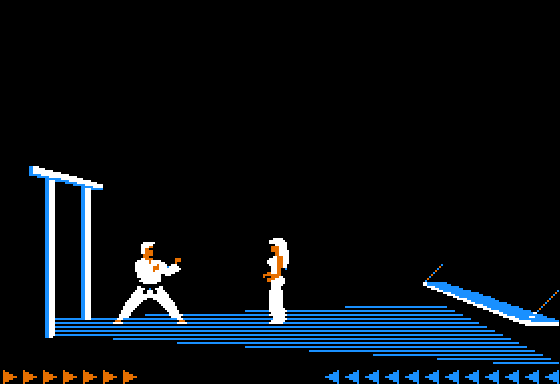
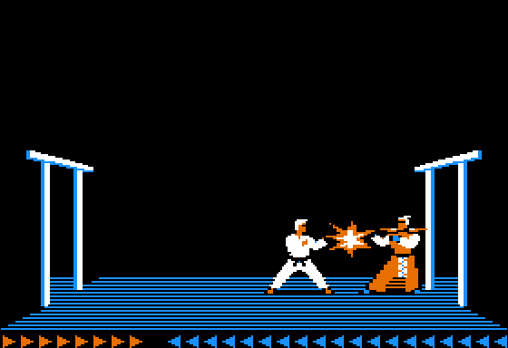
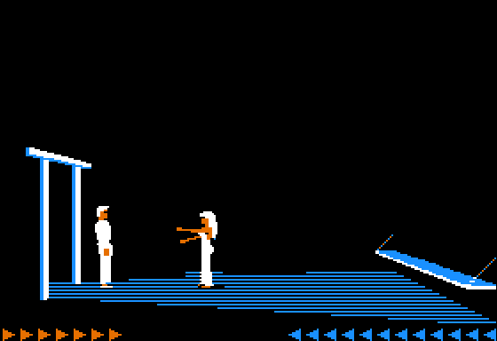
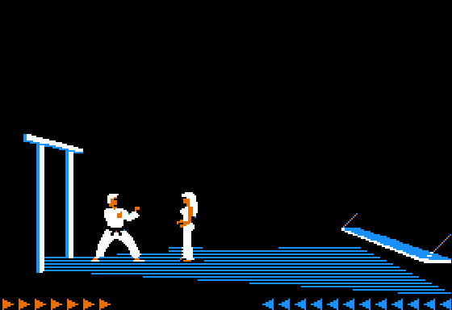
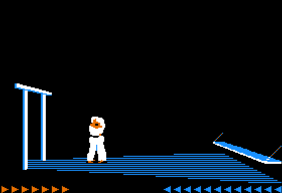
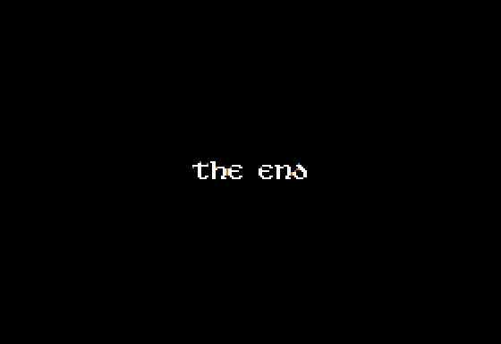

# Karateka Fun — Apple II Edition

[English](README.md) | [한국어](README.ko.md) | [日本語](README.ja.md)

**Apple II版『カラテカ』に、コンティニュー、ステージ選択、マリコとの対戦を追加。**

Apple II版『カラテカ』を、もっと自由に楽しむための非公式MODです。
通常プレイ向けの**基本版**と、実験的な対戦を追加した**マリコ対戦ベータ版**の2種類を配布します。

*このページのスクリーンショットは、マリコ対戦ベータ版で撮影したものです。*

## バージョンを選ぶ

| 種類 | リリースの添付ファイル | 内容 |
|---|---|---|
| **基本版 — 通常プレイにおすすめ** | `Karateka-Continue-Test-Stages.dsk` | コンティニュー、5つのステージへの直接移動、テスト用の攻撃キーを搭載。マリコのイベントとエンディングは原作のままです。 |
| **マリコ対戦ベータ版 — 実験版** | `Karateka-Mariko-Duel.dsk` | 基本機能に加え、マリコとの対戦、色と動きの調整を追加しました。 |

**基本版：** マリコとの対戦モードはありません。マリコの部屋へ直接移動でき、直立姿勢で近づくと、原作の抱擁シーンと物語のエンディングに進みます。

**マリコ対戦ベータ版：** マリコとの戦闘、歩行・姿勢切り替えの改善、肌の色の補正、部屋での接近範囲の制限を含みます。**マリコの戦闘動作とバランスには、さらにベータテストが必要です。**

## 両バージョン共通の機能

- **ステージコンティニュー** — ゲームオーバー時にジョイスティックのボタンを押し続けると、そのステージの最初から再開できます。
- **5つのステージへ直接移動** — `Shift + 1`～`Shift + 5`で、好きな区間へ移動できます。
- **テスト用の攻撃キー** — 戦闘中に`0`を押すと、現在の敵に1 HP分のダメージを与えます。

## ダウンロードと起動

このリポジトリの**[GitHub Releases](https://github.com/apple2forever/karateka-fun/releases)**から、遊びたいバージョンのディスクイメージをダウンロードしてください。
通常プレイには基本版を、追加の対戦をテストする場合はマリコ対戦ベータ版を選んでください。

1. Apple IIエミュレーターを、**Apple IIe**または**16KBのLanguage Card RAMを搭載したApple II**構成に設定します。
2. ダウンロードしたディスクイメージを1台目のディスクドライブに挿入し、起動します。
3. イントロ中にキーを押してゲームを開始し、`J`でジョイスティックモード、`K`でキーボードモードを選びます。

Apple IIe構成で動作を確認しています。コンティニューは現在のプレイ中に使う機能であり、
電源を切った後に進行状況を読み込むセーブ機能ではありません。

## 操作方法

### ジョイスティックモード（`J`）

| 入力 | 動作 |
|---|---|
| 左右 | 移動・接近・後退 |
| ボタン0 | キック |
| ボタン1 | パンチ |
| 上・中央・下＋攻撃ボタン | 上段・中段・下段の攻撃 |
| 攻撃ボタンを押さずに上へ倒し続ける | 直立姿勢・歩行モード |
| 直立姿勢で上＋前 | 前へ走る |
| 上方向の入力を離す | 戦闘姿勢に戻る |

原作では、敵が近いと構えを解くことが制限されます。**マリコ対戦ベータ版では、近距離でも直立姿勢に切り替えられます。**

### キーボードモード（`K`）

| 入力 | 動作 |
|---|---|
| `←` / `→` | 移動 |
| `Space` | 直立姿勢 ↔ 戦闘姿勢の切り替え |
| `W` / `S` / `X` | 上段 / 中段 / 下段キック |
| `Q` / `A` / `Z` | 上段 / 中段 / 下段パンチ |
| `Ctrl + S` | サウンドのオン・オフ |

### 追加操作

| 入力 | 動作 |
|---|---|
| ゲームオーバー時にジョイスティックのボタン0または1を押し続ける | 現在のステージからコンティニュー |
| 戦闘中に`0` | 現在の敵に1 HP分のダメージ |
| `!`（`Shift + 1`） | 道場入口へ向かう道 |
| `@`（`Shift + 2`） | 道場1 — 廊下・落とし格子 |
| `#`（`Shift + 3`） | 道場2 — 屋内・引き戸 |
| `$`（`Shift + 4`） | アクマとのボス戦 |
| `%`（`Shift + 5`） | マリコの部屋 — 基本版では原作イベント、ベータ版では対戦開始 |

コンティニューには**ジョイスティックのボタン入力**を使います。キーボードモードで遊ぶ場合も、
エミュレーターでジョイスティックのボタンに割り当てたキーやボタンで操作できます。
各ステージは、その区間の最初から再開します。

## マリコの原作イベント — 基本版

アクマを倒すか、`%`で部屋へ移動した後、直立姿勢でマリコに近づくと、原作の抱擁シーンと物語のエンディングに進みます。このバージョンにマリコとの対戦はありません。
戦闘姿勢で近づいた際の、原作の一撃で倒されるキックの判定もそのままです。

## マリコと戦う・抱き合う — マリコ対戦ベータ版

アクマを倒すと、マリコとの対戦に進みます。`%`で直接始めることもできます。

- **戦闘姿勢**のままでいると、マリコが近づいて攻撃します。
- **直立姿勢（構えを解いた状態）**に切り替えると、マリコも攻撃をやめます。踏み出している一歩を終えてから、腕を広げて抱擁を待つ姿勢になります。
- 再び**戦闘姿勢**に戻ると、対戦を再開します。
- **直立姿勢で近づくと**、原作の抱擁シーンと物語のエンディングに進みます。
- マリコを**倒すと**、原作のイントロにある倒れるアニメーションを経て、**THE END**で終わります。

主人公とマリコには、部屋の中での移動範囲が設定されています。主人公が左端に追い詰められても、
マリコがその端まで押し込み続けないよう、接近範囲を制限しました。
被弾時の反応や後退は、攻撃を受けた瞬間の姿勢によって変わります。
マリコが抱擁を待っている間は、テスト用の`0`攻撃は適用されません。

| 構えを解くとマリコが抱擁を待つ | 再び戦闘姿勢へ |
|---|---|
|  |  |

| 直立姿勢で近づくと抱擁 | マリコを倒すとTHE END |
|---|---|
|  |  |

勝利後は、ボタンをいったん離してから再び押すと、ゲームを最初から始められます。

## 原作

**Karateka** · Jordan Mechner · Brøderbund · 1984.

原作ゲームをもとにした非公式ファンMODです。
