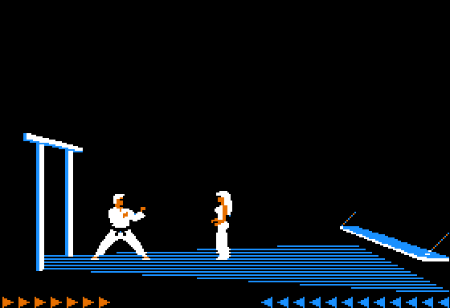
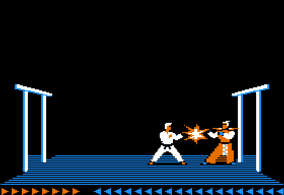
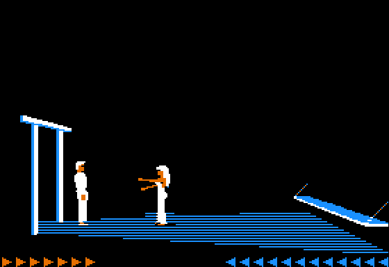
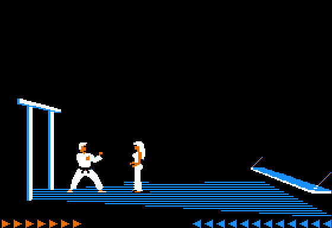
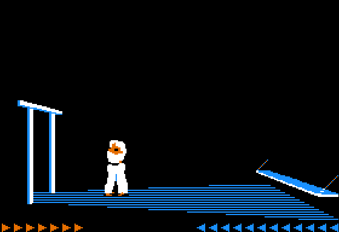
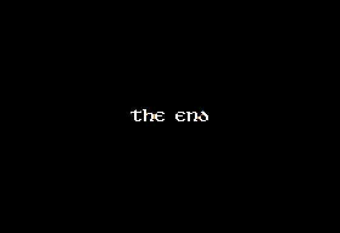

# Karateka Fun — Apple II Edition

[English](README.md) | [한국어](README.ko.md) | [日本語](README.ja.md)

**컨티뉴, 스테이지 선택, 마리코 대련을 더한 Apple II Karateka 모드.**

Apple II판 《Karateka》를 조금 더 자유롭게 즐기기 위한 비공식 모드입니다.
일반 플레이용 **기본판**과, 실험적인 마리코 대련을 추가한 **마리코 대련 베타판** 두 종류로 배포합니다.

*이 페이지의 스크린샷은 마리코 대련 베타판에서 캡처했습니다.*

## 버전 선택

| 구분 | 릴리즈 첨부 파일 | 내용 |
|---|---|---|
| **기본판 — 일반 플레이 권장** | `Karateka-Continue-Test-Stages.dsk` | 컨티뉴·5개 스테이지 이동·테스트 타격을 제공합니다. 마리코는 원작 이벤트와 엔딩을 유지합니다. |
| **마리코 대련 베타판 — 실험 버전** | `Karateka-Mariko-Duel.dsk` | 기본 기능에 마리코 대련과 그림·동작 보정을 추가했습니다. |

**기본판:** 마리코와 싸우는 모드는 없습니다. 마리코의 방에 바로 이동할 수 있으며, 차렷 자세로 접근하면 원작 포옹과 이야기 엔딩으로 이어집니다.

**마리코 대련 베타판:** 마리코와의 전투, 걷기·자세 전환 개선, 피부색 보정, 방 안의 접근 제한을 포함합니다. **마리코의 전투 동작과 밸런스는 추가 베타테스트가 필요합니다.**

## 두 버전의 공통 기능

- **스테이지 컨티뉴** — 게임오버 때 조이스틱 버튼을 누르고 있으면 해당 스테이지에서 다시 시작합니다.
- **5개 스테이지 바로 이동** — `Shift + 1`부터 `Shift + 5`까지 원하는 구간으로 이동합니다.
- **테스트 타격** — 전투 중 `0`으로 현재 적에게 1 HP의 타격을 줍니다.

## 다운로드와 실행

이 저장소의 **[GitHub Releases](https://github.com/apple2forever/karateka-fun/releases)**에서 원하는 버전의 디스크 이미지를 내려받으세요.
일반 플레이에는 기본판을, 추가 대련을 테스트하려면 마리코 대련 베타판을 선택하면 됩니다.

1. Apple II 에뮬레이터를 **Apple IIe** 또는 **16KB Language Card RAM을 갖춘 Apple II** 구성으로 설정합니다.
2. 내려받은 디스크 이미지를 첫 번째 디스크 드라이브에 넣고 부팅합니다.
3. 인트로에서 키를 눌러 시작한 뒤, `J`로 조이스틱 또는 `K`로 키보드 모드를 선택합니다.

Apple IIe 구성에서 동작을 확인했습니다. 컨티뉴는 현재 실행 중에 사용하는 기능이며,
전원을 껐다 켠 뒤 진행을 불러오는 저장 기능은 아닙니다.

## 조작

### 조이스틱 모드 (`J`)

| 입력 | 동작 |
|---|---|
| 좌우 | 이동·접근·후퇴 |
| 버튼 0 | 발차기 |
| 버튼 1 | 주먹 공격 |
| 위·가운데·아래 + 공격 버튼 | 상단·중단·하단 공격 |
| 공격 버튼 없이 위를 유지 | 차렷·걷기 자세 |
| 차렷 중 위 + 앞 | 앞으로 달리기 |
| 위를 놓기 | 전투 자세로 복귀 |

원작의 적과 가까울 때는 차렷 전환이 제한됩니다. **마리코 대련 베타판에서는 가까워도 차렷으로 전환할 수 있습니다.**

### 키보드 모드 (`K`)

| 입력 | 동작 |
|---|---|
| `←` / `→` | 이동 |
| `Space` | 차렷 ↔ 전투 자세 전환 |
| `W` / `S` / `X` | 상단 / 중단 / 하단 발차기 |
| `Q` / `A` / `Z` | 상단 / 중단 / 하단 주먹 공격 |
| `Ctrl + S` | 소리 켜기·끄기 |

### 추가 키

| 입력 | 동작 |
|---|---|
| 게임오버에서 조이스틱 버튼 0 또는 1 유지 | 현재 스테이지에서 컨티뉴 |
| 전투 중 `0` | 현재 적에게 1 HP 타격 |
| `!` (`Shift + 1`) | 도장 입구까지 가는 길 |
| `@` (`Shift + 2`) | 도장 1 — 복도·철창문 |
| `#` (`Shift + 3`) | 도장 2 — 실내·미닫이문 |
| `$` (`Shift + 4`) | 아쿠마 보스전 |
| `%` (`Shift + 5`) | 마리코의 방 — 기본판은 원작 이벤트, 베타판은 대련 시작 |

컨티뉴는 **조이스틱 버튼 입력**을 사용합니다. 키보드 모드에서 플레이하더라도
에뮬레이터에 지정된 조이스틱 버튼을 누르면 사용할 수 있습니다.
스테이지는 해당 구간의 시작 상태에서 다시 시작합니다.

## 마리코의 원작 이벤트 — 기본판

아쿠마를 쓰러뜨리거나 `%`로 방에 이동한 뒤, 차렷 자세로 마리코에게 접근하면 원작 포옹과 이야기 엔딩으로 이어집니다. 이 버전에는 마리코 대련이 없습니다.
전투 자세로 접근하면 원작의 즉사 발차기 판정이 유지됩니다.

## 마리코와 대련하거나 포옹하기 — 마리코 대련 베타판

아쿠마를 쓰러뜨리면 마리코 대련으로 이어집니다. `%`로 곧바로 시작할 수도 있습니다.

- **전투 자세**를 유지하면 마리코가 다가와 공격합니다.
- **차렷 자세**로 바꾸면 마리코도 공격을 멈추고, 현재 걸음을 마친 뒤 포옹 대기 자세로 바뀝니다.
- 다시 **전투 자세**로 돌아가면 대련을 재개합니다.
- **차렷 자세로 가까이 다가가면** 원작 포옹과 이야기 엔딩으로 이어집니다.
- 마리코를 **쓰러뜨리면** 원작 인트로의 쓰러짐 동작을 거쳐 **THE END**로 끝납니다.

주인공과 마리코 모두 방의 이동 한계가 있습니다. 주인공이 왼쪽 끝에 몰려도
마리코가 그 끝까지 계속 밀고 들어오지 않도록 접근 범위를 제한했습니다.
피격 반응과 후퇴는 맞은 순간의 자세에 따라 달라집니다.
포옹 대기 중에는 테스트용 `0` 타격이 적용되지 않습니다.

| 차렷 시 포옹 대기 | 다시 전투 자세로 복귀 |
|---|---|
|  |  |

| 차렷으로 접근하면 포옹 | 마리코를 쓰러뜨리면 THE END |
|---|---|
|  |  |

승리 후에는 버튼을 놓았다가 새로 눌러 게임을 처음부터 시작할 수 있습니다.

## 원작

**Karateka** · Jordan Mechner · Brøderbund · 1984.

원작 게임을 바탕으로 한 비공식 팬 모드입니다.
