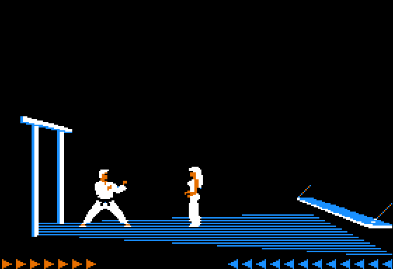
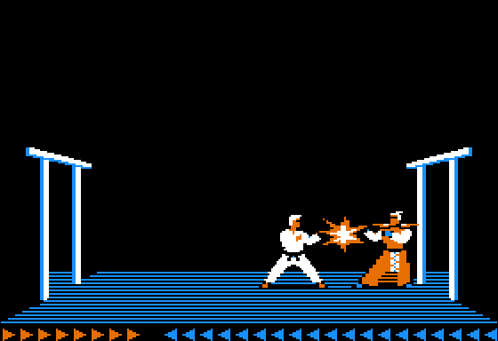
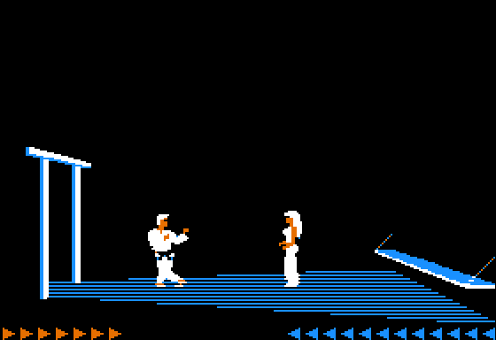
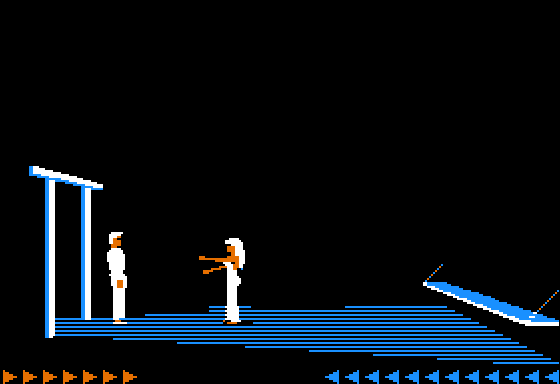
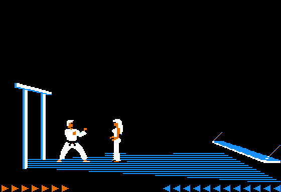
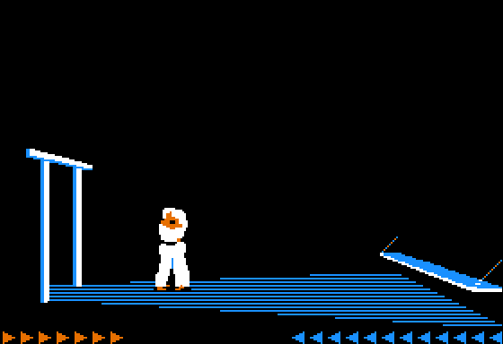
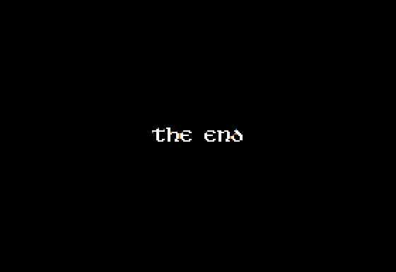

# Karateka Fun — Apple II Edition

[English](README.md) | [한국어](README.ko.md) | [日本語](README.ja.md)

**Fun mods for Apple II Karateka — continue, stage select, and Mariko duel.**

An unofficial mod that adds more ways to enjoy the Apple II version of *Karateka*.
Two editions are available: the **Base Edition** for regular play, and the **Mariko Duel Beta** for trying the experimental duel.

*Screenshots on this page are from the Mariko Duel Beta.*

## Choose an edition

| Edition | Release asset | Description |
|---|---|---|
| **Base Edition — recommended for regular play** | `Karateka-Continue-Test-Stages.dsk` | Continues, five stage shortcuts, and the test-hit key. Preserves the original Mariko event and ending. |
| **Mariko Duel Beta — experimental** | `Karateka-Mariko-Duel.dsk` | Includes the base features, plus a duel with Mariko and visual and animation improvements. |

**Base Edition:** Mariko is not a combat opponent. You can enter her room directly and approach with your arms lowered for the original embrace and story ending.

**Mariko Duel Beta:** Adds combat with Mariko, refined walking and stance transitions, skin-color corrections, and an approach limit within the room. **Mariko's combat behavior and balance need further beta testing.**

## Features in both editions

- **Stage continues** — Hold a joystick button at game over to restart the current stage.
- **Five stage shortcuts** — Use `Shift + 1` through `Shift + 5` to jump to a stage.
- **Test hits** — Press `0` during combat to deal 1 HP of damage to the current enemy.

## Download and play

Download the disk image for your preferred edition from this repository's **[GitHub Releases](https://github.com/apple2forever/karateka-fun/releases)**.
For regular play, choose the Base Edition. Choose the Mariko Duel Beta to help test the additional duel.

1. Configure your Apple II emulator as an **Apple IIe**, or as an **Apple II with 16KB of Language Card RAM**.
2. Insert the downloaded disk image into the first disk drive and boot it.
3. Press a key during the intro to start, then select joystick mode with `J` or keyboard mode with `K`.

The mod has been tested with an Apple IIe configuration. Continues work within the current session;
they do not save progress for loading after the machine is powered off.

## Controls

### Joystick mode (`J`)

| Input | Action |
|---|---|
| Left / right | Move, approach, or retreat |
| Button 0 | Kick |
| Button 1 | Punch |
| Up / center / down + attack button | High / middle / low attack |
| Hold up without an attack button | Relaxed stance / walking mode |
| Up + forward while relaxed | Run forward |
| Release up | Return to fighting stance |

The original game restricts lowering your guard near an enemy. **In the Mariko Duel Beta, you can lower your guard even at close range.**

### Keyboard mode (`K`)

| Input | Action |
|---|---|
| `←` / `→` | Move |
| `Space` | Switch between relaxed and fighting stances |
| `W` / `S` / `X` | High / middle / low kick |
| `Q` / `A` / `Z` | High / middle / low punch |
| `Ctrl + S` | Toggle sound |

### Extra controls

| Input | Action |
|---|---|
| Hold joystick button 0 or 1 at game over | Continue from the current stage |
| `0` during combat | Deal 1 HP of damage to the current enemy |
| `!` (`Shift + 1`) | The road to the dojo entrance |
| `@` (`Shift + 2`) | Dojo 1 — corridor and portcullis |
| `#` (`Shift + 3`) | Dojo 2 — interior and sliding doors |
| `$` (`Shift + 4`) | Akuma boss fight |
| `%` (`Shift + 5`) | Mariko's room — original event in the Base Edition; duel in the Beta |

Continues use **joystick button input**. Even when playing in keyboard mode,
you can continue using the keys or buttons your emulator maps to joystick buttons.
Each stage restarts from its beginning.

## Mariko's original event — Base Edition

After defeating Akuma, or entering her room with `%`, approach Mariko with your arms lowered for the original embrace and story ending. There is no Mariko duel in this edition.
Approaching in fighting stance retains the original fatal-kick behavior.

## Fight or embrace Mariko — Mariko Duel Beta

Defeating Akuma leads to the Mariko duel. You can also start it directly with `%`.

*Actual combat footage — 560×384, vertical scale 2×, normal playback speed.*

- Stay in **fighting stance** and Mariko will approach and attack.
- Switch to a **relaxed stance, with your arms lowered**, and Mariko stops attacking. She finishes her current step, then holds out her arms and waits for an embrace.
- Return to **fighting stance** to resume the duel.
- **Approach with your arms lowered** to trigger the original embrace and story ending.
- **Defeat Mariko** and she falls using an animation from the original intro, followed by **THE END**.

Both characters have movement limits within the room. Mariko's approach is limited so that she cannot
keep pushing all the way into the left edge when the hero is cornered.
Hit reactions and retreat depend on the character's stance at the moment of impact.
The test-hit key `0` has no effect while Mariko is waiting for an embrace.

| Mariko waits when you lower your guard | Return to fighting stance |
|---|---|
|  |  |

| Approach with your arms lowered for an embrace | Defeat Mariko to reach THE END |
|---|---|
|  |  |

After winning, release the button and press it again to restart the game from the beginning.

## Original game

**Karateka** · Jordan Mechner · Brøderbund · 1984.

This is an unofficial fan mod based on the original game.
